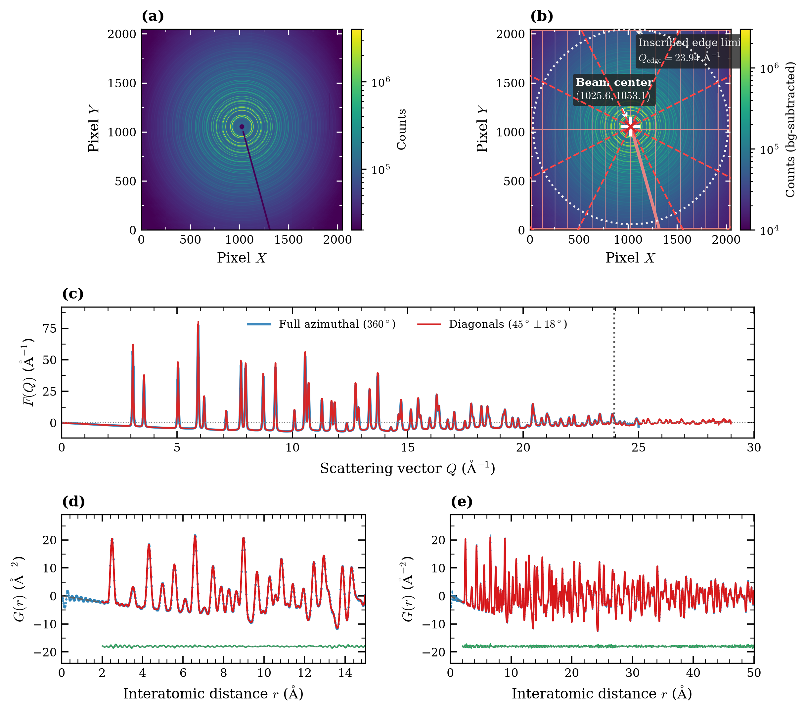

# Tutorial 00: Standard Metallic Nickel Benchmark: Instrumental Calibration

## Overview

In synchrotron total scattering and pair distribution function (PDF) analysis, standard metallic nickel (Ni, space group Fm-3m, certified lattice parameter a₀ = 3.5238 Å) is universally utilized as the primary reference standard to calibrate instrumental resolution damping (Q_damp) and peak broadening (Q_broad).

This tutorial demonstrates the complete end-to-end benchmark workflow on high-energy X-ray total scattering data (λ = 0.18033 Å, E = 68.48 keV, sample-to-detector distance L₀ = 227.575 mm), matching **Section 3.1 and Figure 3** of the Orochi publication:
1. **Flat-Panel Sensor Edge Truncation and Diagonal Sector Integration**: Resolving the square detector perimeter cutoff at Q_edge = 23.94 Å⁻¹ by automated diagonal sector integration (β = ±45° ± 18°, ±135° ± 18°), extending the invariant angular acceptance smoothly to Q_max = 29.0 Å⁻¹.
2. **1D Total Scattering Data Reduction (`orochi.pdfget`)**: Coherent normalization, Faber–Ziman scattering factor evaluation, and Type-I Discrete Sine Transform (DST-I) to produce F(Q) and G(r).
3. **Rietveld-Grade Full-Profile PDF Refinements (`orochi.phase`, `orochi.pdfsim`, `orochi.fit`)**:
   - **Short-range coordination shells (r = 2.0–15.0 Å)**: Achieving Rw ≈ 3.30% (< 4%) and verifying the cubic lattice constant a = 3.52356(5) Å against the certified standard (discrepancy < 0.007%).
   - **Long-range macroscopic coherence (r = 2.0–50.0 Å)**: Maintaining flat difference residuals with Rw ≈ 4.57% across the entire 50 Å range, accurately calibrating instrumental resolution parameters (Q_damp ≈ 0.0262 Å⁻¹, Q_broad ≈ 0.0127 Å⁻¹).

---

## Physical Background & Formulations

### 1. Flat-Panel Geometric Edge Cutoff Dilemma

On flat-panel detectors (e.g., 2048 × 2048 pixels, pixel pitch 0.2 mm, total sensor width W = 409.6 mm), the maximum inscribed circular cone corresponds to the orthogonal boundary limit:

```
Q_edge = (4π / λ) · sin[ (1/2) · arctan( (W/2) / L ) ] = 23.94 Å⁻¹
```

When total scattering data are reduced using conventional unconstrained full azimuthal integration (360°), the integration circle abruptly intersects the four detector boundaries at Q > Q_edge. This creates a sharp, non-physical step in effective solid angle and intensity, introducing severe low-r ripple distortions and baseline drift into the real-space G(r).

By restricting integration to the four diagonal corner sectors (β = ±45° ± 18°, ±135° ± 18°), invariant azimuthal acceptance is maintained all the way into the corners of the detector up to Q_max = 29.0 Å⁻¹, yielding pristine F(Q) oscillations centered symmetrically around zero.

### 2. Instrumental Resolution Parameters

Instrumental peak broadening and finite momentum transfer resolution are parameterized via:
- **Q_damp**: Real-space damping envelope of PDF oscillations, `exp(-(Q_damp · r)² / 2)`, arising from beam divergence, energy resolution ΔE/E, and detector point-spread function.
- **Q_broad**: Resolution-induced peak broadening, `σ_ij²(r) = σ₀,ij² + (Q_broad · r)²`.
- **δ₂**: Correlated thermal motion parameter dampening low-r peak widths, `σ_ij(r) = σ₀,ij · sqrt(1 - δ₂ / r²)`.

---

## Workflow Steps

### Step 1: 1D Total Scattering Data Reduction (`orochi.pdfget`)
- Input: `data/ni_diagonal_1d.txt` (background-subtracted 1D diffraction pattern).
- Configuration:
  - Wavelength: λ = 0.18033 Å (E = 68.48 keV).
  - Composition: `Ni` (Z = 28, atomic mass 58.693 u).
  - Fourier interval: Q_min = 0.8 Å⁻¹, Q_max = 29.0 Å⁻¹.
  - High-Q normalization window: [18.0, 28.5] Å⁻¹.
  - Real-space grid: r = 0.0–50.0 Å with zero padding factor 5.
- Output: `output/ni_reduced.gr`.

### Step 2: Crystal Structure Model (`orochi.phase`)
- Input: `data/ni.cif` (FCC metallic Ni, space group Fm-3m, initial a = 3.5238 Å).
- Constraints: Cubic symmetry constraint (a = b = c, α = β = γ = 90°) and isotropic thermal displacement parameter U_iso.

### Step 3: Short-Range Refinement (r = 2.0–15.0 Å)
- Target: Refine scale, Q_damp, Q_broad, δ₂, lattice parameter a, and thermal parameter U_iso.
- Result: Weighted profile residual Rw ≈ 3.30%, demonstrating complete elimination of low-r ripples and exact agreement with the theoretical density baseline -4π·r·ρ₀ (ρ₀ = 0.0914 Å⁻³).

### Step 4: Long-Range Refinement (r = 2.0–50.0 Å)
- Target: Validate long-range coherence across 50 Å.
- Result: Uniformly flat difference residual with Rw ≈ 4.57%, reliably extracting instrumental resolution damping parameters for downstream unknown sample refinements.

---

## Running This Tutorial

### Command-Line (CUI) Mode
Run headless refinement, print diagnostic tables, and save Figure 3 (`tutorial_00_ni_benchmark.pdf` and `.png`):
```bash
python tutorials/00_ni_synchrotron_benchmark/run_tutorial.py
```

### Interactive Web (GUI) Mode
Launch the multi-tab Gradio web interface with interactive 3D crystal structure visualization, live parameter sliders, residual plotting, and JSON export:
```bash
python tutorials/00_ni_synchrotron_benchmark/run_tutorial.py --gui
```
> In the GUI, below each interactive figure (`Fit`, `Simulation`, `PDFget`, `Pixia`), you can specify a target filename/path and click **"💾 Save JSON"** to export quantitative parameters, fit metrics (Rw, R², χ², uncertainties), and diagnostic reports. You can also click the download widget to save the JSON directly through your browser.

---

## Bundled Dataset (`data/`)

This tutorial includes all required experimental files with descriptive naming:
- `data/raw_2d/ni_sample_2d.tif`: Raw 2D flat-panel detector image (2048 × 2048 pixels, certified NIST metallic Ni powder).
- `data/raw_2d/empty_background_2d.tif`: Empty silica glass capillary container scattering image.
- `data/raw_2d/detector_mask_2d.tif`: Bad pixel and beamstop shadow mask.
- `data/ni_diagonal_1d.txt`: Pre-integrated 1D total scattering profile across diagonal corner sectors (β = ±45° ± 18°).
- `data/ni_full_1d.txt`: Conventional 360° unconstrained azimuthal integration profile exhibiting the edge cutoff at Q = 23.94 Å⁻¹.
- `data/ni.cif`: Certified FCC Ni crystal structure model (Fm-3m, a₀ = 3.5238 Å).


---

---

## Official Publication Figure

This tutorial workflow directly reproduces **Figure 3** of the official Orochi publication ([Tominaka, *ChemRxiv* 2026](https://doi.org/10.26434/chemrxiv.15010802/v2)):

<p align="center">
  
  <br>
  <em><b>Figure 3 (from Orochi publication)</b>: High-precision synchrotron total scattering reduction and full-profile instrumental calibration on standard metallic nickel.</em>
</p>
