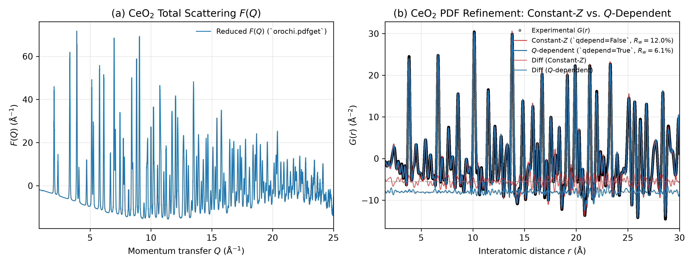

# Tutorial 01: Total Scattering Data Reduction and Q-Dependent Form-Factor PDF Refinement of Bulk CeO2

## Overview

In X-ray Pair Distribution Function (PDF) analysis of multi-element materials containing both heavy and light elements—such as fluorite-type cerium dioxide (CeO₂, space group Fm-3m, Z_Ce = 58, Z_O = 8)—the normalized Q-dependence of the atomic scattering factors f_Ce(Q)/Z_Ce and f_O(Q)/Z_O differs substantially across momentum transfer space.

This tutorial demonstrates the complete **Orochi 4.0** workflow from 1D total scattering data reduction (`orochi.pdfget`) to real-space structural refinement (`orochi.phase`, `orochi.pdfsim`, `orochi.fit`), highlighting why exact Q-dependent pair weighting via Discrete Cosine Transform (DCT) convolution (`qdepend = True`) is essential for quantitative X-ray PDF refinement.

## Workflow Steps

### Step 0 (Optional): 2D Detector Image Integration (`orochi.pixia`)
1. In total scattering experiments, diffraction data are collected on large 2D flat-panel area detectors (`ceo2.tif`, `empty.tif`, `mask.tif`).
2. `orochi.pixia` applies flat-field corrections, dark current/mask subtraction, and azimuthal integration across high-symmetry diagonal sectors (β = ±45° ± 18°) to avoid detector edge cutoff artifacts.
3. Automatically outputs calibrated 1D diffraction patterns directly into `orochi.pdfget`.

### Step 1: 1D Total Scattering Data Reduction (`orochi.pdfget`)
1. Load the azimuthally integrated X-ray total scattering profile of CeO₂ (`ceo2_pixia_data.txt` or integrated from 2D TIFF, λ = 0.1777 Å, E ≈ 69.77 keV).
2. Configure `PDFget` with chemical composition `CeO2`, Q_min = 1.0 Å⁻¹, and Q_max = 25.0 Å⁻¹.
3. Run `pdfget.tune()` (or `pdfget()`) to normalize the high-Q intensity against the independent atomic scattering `⟨|f(Q)|²⟩ + I_Compton(Q)`, subtract the baseline, and apply the Type-I Discrete Sine Transform (DST-I) to obtain F(Q) and G(r).

### Step 2: Crystal Structure Initialization (`orochi.phase`)
1. Load `CeO2.cif` (Fm-3m, a ≈ 5.411 Å) into `Phase`.
2. Set `phase["shape_type"] = "analytical"` and `phase["sphere"] = [1000.0, 1000.0, 1000.0]` to represent a bulk crystal.
3. Enable symmetry and cubic lattice constraints so that the unit cell parameter a and isotropic atomic displacement parameters (U_iso(Ce), U_iso(O)) are refined under Fm-3m symmetry.

### Step 3: Constant-Z vs. Q-Dependent Scattering Factor Refinement (`orochi.pdfsim` & `orochi.fit`)
1. **Constant-Z Approximation (`sim["qdepend"] = False`)**:
   - Pair weights are approximated as Q-independent constants `W_ij = Z_i · Z_j / ⟨Z⟩²`.
   - Refine `scale`, `qdamp`, `qbroad`, `delta2`, cubic lattice parameter `a`, and site ADPs `U_iso(Ce)`, `U_iso(O)` over r = 1.5–30.0 Å using `LeastSquaresOptimizer`.
2. **Exact Q-Dependent Complex Scattering Factors (`sim["qdepend"] = True`)**:
   - Pair weights `W_ij(Q) = |f_i(Q, E) · f_j(Q, E)| / |⟨f(Q, E)⟩|²` are transformed into real-space pair-broadening kernels via Type-II DCT and convolved with each partial pair histogram `g_ij(r)`.
   - Repeat the least-squares refinement over the identical parameter set and compare the weighted profile agreement factor Rw, refined ADPs, and partial pair profiles.

## Running This Tutorial

- **Command-Line (CUI) Mode**:
  ```bash
  python run_tutorial.py
  ```
- **Interactive Web (GUI) Mode**:
  ```bash
  python run_tutorial.py --gui
  ```
  > In the GUI, below each interactive figure (`Fit`, `Simulation`, `PDFget`, `Pixia`), you can specify a target filename/path and click **"💾 Save JSON"** to export quantitative parameters, fit metrics (Rw, R², χ², uncertainties), and diagnostic reports. You can also click the download widget to save the JSON directly through your browser.

---

## Bundled Dataset (`data/`)

This tutorial includes all required experimental files with descriptive naming:
- `data/raw_2d/ceo2_sample_2d.tif`: Raw 2D flat-panel detector image (2048 × 2048 pixels, bulk fluorite CeO₂).
- `data/raw_2d/empty_background_2d.tif`: Empty silica glass capillary container scattering image.
- `data/raw_2d/detector_mask_2d.tif`: Bad pixel and beamstop shadow mask.
- `data/ceo2_diagonal_1d.txt`: Pre-integrated 1D total scattering profile across diagonal corner sectors.
- `data/CeO2.cif`: Fluorite CeO₂ crystal structure model (Fm-3m, a ≈ 5.411 Å).
- `data/CeO2.gr`: Pre-reduced pair distribution function G(r) reference profile.


---

## Expected Output Figure


