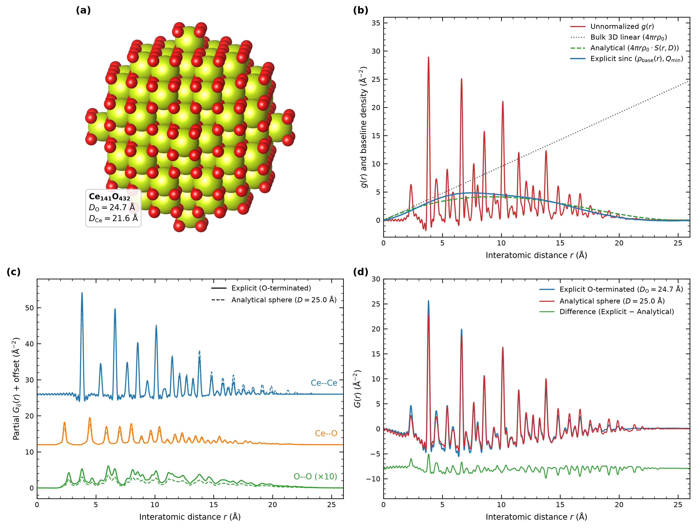

# Tutorial 02: Coordination-Preserving Explicit Nanoparticle Modeling vs. Analytical Spherical Envelope for CeO2

## Overview

In conventional Pair Distribution Function (PDF) refinements of nanoparticles, finite-size attenuation is commonly approximated by multiplying the bulk periodic correlation function by a uniform analytical spherical envelope:

```
S(r; D) = [1 - (3/2) · (r/D) + (1/2) · (r/D)³] · Θ(D - r)
```

While convenient, this analytical approximation implicitly assumes that **all chemical species are distributed with uniform spatial probability up to the same outer radius R = D/2**.

In real metal-oxide nanocrystals such as CeO₂, however, surface cations cannot exist as isolated, severely under-coordinated bare ions; instead, nanoparticles terminate with coordinating oxygen anions so that the cation coordination polyhedra (CeO₈ cubes in fluorite CeO₂) remain intact.

`orochi.phase` directly models this physical surface chemistry when `phase["shape_type"] = "sphere"` (or `"cube"`, `"octahedron"`, `"cylinder"`) is selected:
1. A supercell is expanded and carved to the nominal diameter D (`apply_shape_function`).
2. Formal ionic charges (Ce⁴⁺, O²⁻), ionic radii, and bulk coordination numbers (CN_Ce = 8) are evaluated from the internal crystallographic database.
3. Under-coordinated surface cations (CN_Ce < 8) are automatically trimmed while all anions coordinating at least one remaining cation (CN_O ≥ 1) are retained (`trim_under_coordinated_ions`).

## Physical Consequences of O-Termination

For a nominal D = 25.0 Å (R = 12.5 Å) CeO₂ nanoparticle:
- **Composition & Surface Termination**: The resulting explicit cluster contains **573 atoms** with formula Ce₁₄₁O₄₃₂ (O/Ce = 3.064 vs. bulk 2.000), reflecting the oxygen-rich surface termination layer that completes the outer CeO₈ polyhedra.
- **Inhomogeneous Radial Distribution of Elements**:
  - Ce⁴⁺ cations are confined to the interior core with maximum radial distance R_Ce,max = 10.82 Å (effective Ce core diameter D_Ce ≈ 21.65 Å).
  - O²⁻ anions extend to the outer termination shell at R_O,max = 12.33 Å (effective outer diameter D_O ≈ 24.65 Å).
- **Deviation from the Uniform Spherical Approximation**:
  - Because Ce and O occupy different effective volumes within the same nanoparticle, the partial pair correlations attenuate at different rates with interatomic distance r: Ce–Ce correlations decay more rapidly and vanish above ~21.6 Å, whereas Ce–O and O–O correlations extend to ~23.1 Å and ~24.6 Å, respectively.
  - Consequently, if the X-ray PDF of an O-terminated CeO₂ nanoparticle is fitted using the conventional uniform analytical spherical model (`shape_type = "analytical"`), the refined diameter is dominated by the strongly scattering Ce–Ce sublattice and **systematically underestimates the true outer particle diameter** while leaving pair-dependent structural residuals.

## Running This Tutorial

- **Command-Line (CUI) Mode**:
  ```bash
  python run_tutorial.py
  ```
- **Interactive Web (GUI) Mode**:
  ```bash
  python run_tutorial.py --gui
  ```


---

---

## Official Publication Figure

This tutorial workflow directly reproduces **Figure 5** of the official Orochi publication ([Tominaka, *ChemRxiv* 2026](https://doi.org/10.26434/chemrxiv.15010802/v2)):

<p align="center">
  
  <br>
  <em><b>Figure 5 (from Orochi publication)</b>: Explicit coordination-preserving modeling of oxide nanoparticles and breakdown of the uniform analytical sphere approximation.</em>
</p>
