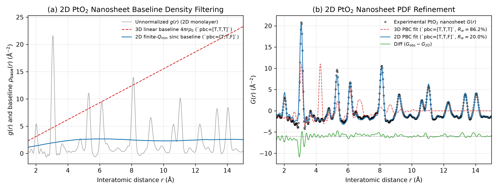

# Tutorial 03: 2D Periodic Boundary Conditions and Finite-Q_min Baseline Density Filtering for PtO2 Nanosheets

## Overview

In three-dimensional bulk crystals (`pbc = [True, True, True]`), the continuum number-density baseline subtracted from the pair correlation function g(r) to form the reduced PDF G(r) is strictly linear in r:

```
ρ_base,3D(r) = 4π · r · ρ₀,    where ρ₀ = N_cell / V_cell
```

For low-dimensional nanostructures such as 2D nanosheets (`pbc = [True, True, False]`), 1D nanowires (`pbc = [False, False, True]`), or 0D clusters (`pbc = [False, False, False]`), however, the unit-cell volume V_cell contains arbitrary vacuum padding along the non-periodic axes, and the local continuum density of atom pairs within a single sheet scales sub-linearly with r once r exceeds the sheet thickness.

Furthermore, experimental X-ray PDFs are integrated from a finite minimum momentum transfer Q_min > 0 (imposed by the beamstop shadow), which truncates low-Q small-angle scattering and replaces the linear continuum baseline with a sinc low-pass-filtered baseline.

`orochi.phase` and `orochi.pdfsim` handle arbitrary dimensionality directly:
1. **Anisotropic Periodic Boundary Conditions (`phase["pbc"] = [True, True, False]`)**: Supercell lattice translations in `Simulator.calc_translational_vector()` are restricted exclusively to the in-plane periodic axes (a and b), preventing artificial interlayer pair correlations across the c-axis.
2. **Finite-Q_min Sinc-Filtered Baseline (`Simulator.calc_density()`)**: Whenever `sum(pbc) < 3` or `shape_type != "analytical"`, `orochi.pdfsim` automatically computes the baseline density ρ_base(r) by convolving the unnormalized pair correlation function g(r) with the exact low-pass sinc kernel defined by Q_min:
   ```
   ρ_base(r) = ∫ g(r') · { sin[Q_min · (r - r')] - sin[Q_min · (r + r')] } / [π · (r - r')] dr'
   ```

## Experimental Data & WKM Solvent Subtraction

The experimental dataset provided in this tutorial was collected on exfoliated single-layer PtO₂ nanosheets (λ = 0.18105 Å, Q_max = 26.0 Å⁻¹):
- **Preferred orientation suppression**: Measured as a wet colloidal dispersion to ensure isotropic Debye–Scherrer averaging via Brownian rotational diffusion.
- **Warren–Krutter–Morningstar (WKM) solvent subtraction**: The scattering of the supernatant solution is subtracted from the concentrated dispersion to isolate the pristine monolayer diffraction pattern.

## Running This Tutorial

- **Command-Line (CUI) Mode**:
  ```bash
  python run_tutorial.py
  ```
- **Interactive Web (GUI) Mode**:
  ```bash
  python run_tutorial.py --gui
  ```


---

## Expected Output Figure

<p align="center">
  
  <br>
  <em><b>Expected Output</b>: PtO2 2D Nanosheet PDF Refinement under 2D PBC</em>
</p>
